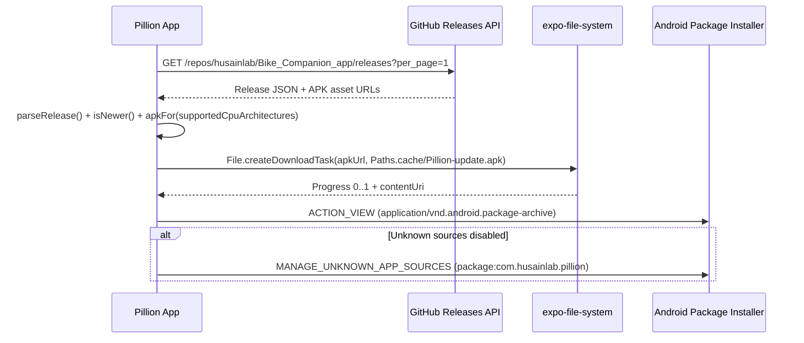

# Pillion Release, Signing & In-App Update Architecture

## Overview
Pillion uses Continuous Native Generation (CNG) so `android/` is generated cleanly on every CI build from `app.json`, `plugins/`, and `modules/pillion-native/`.


## Signing Configuration
No GitHub Secrets are required. Release APKs are signed with the committed PKCS#12 keystore (`credentials/release.keystore`, alias `pillion-release`) wired through [withReleaseSigning.js](../plugins/withReleaseSigning.js) and [build-apk.yml](../.github/workflows/build-apk.yml), ensuring every release shares the exact same signing identity for seamless in-place updates.

You can override the keystore location or credentials via `RELEASE_STORE_FILE`, `RELEASE_STORE_PASSWORD`, `RELEASE_KEY_ALIAS`, and `RELEASE_KEY_PASSWORD` environment variables.

## In-App GitHub Releases Self-Updater



## Manual Fallback Release Script
If you build an APK locally and want to publish it to GitHub Releases directly:
```bash
GITHUB_TOKEN=ghp_... ./scripts/github-release.sh 1.0.1 ./Pillion-1.0.1.apk
```

